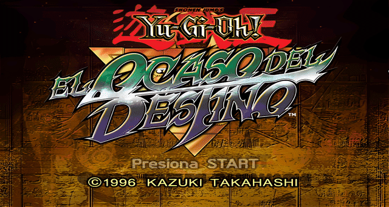
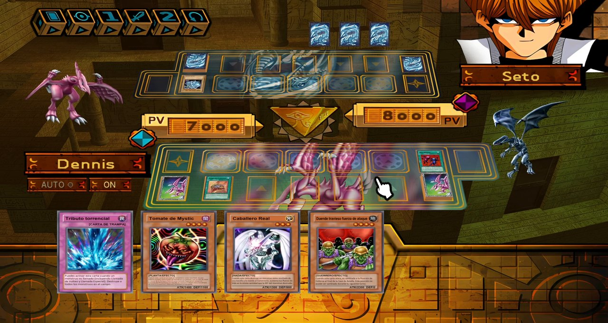
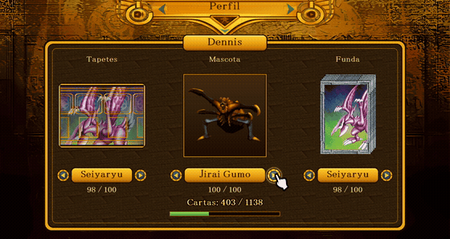
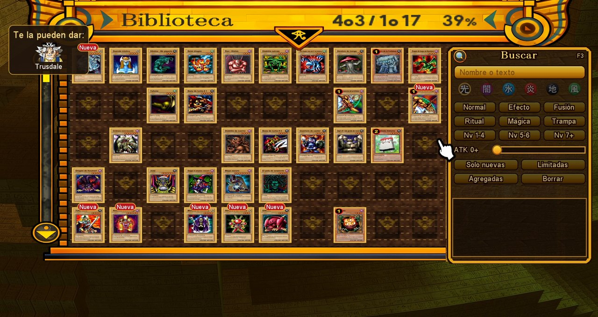
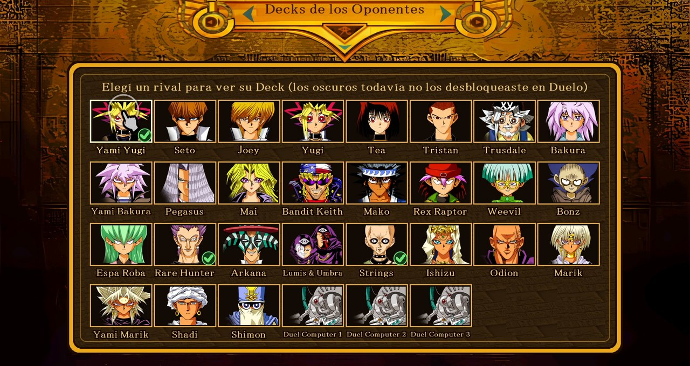
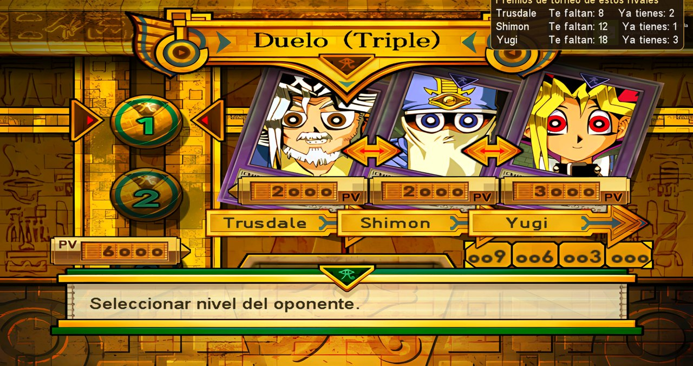
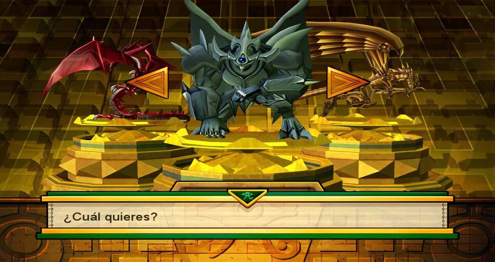

# Yu-Gi-Oh! The Dawn of Destiny — PC port (Xbox static recompilation)

**[English](#english) · [Español](#español)**
(Xbox, PAL/Europe version)

<p align="center"></p>

| | |
|:---:|:---:|
|  |  |
|  |  |
|  |  |

### Downloads / Descargas

| | |
|---|---|
| **Game port / Port del juego** (required / obligatorio) | [YuGiOh-TDOD-PC.zip — Releases](https://github.com/dennisabalo18-bot/yugioh-tdod-pc/releases/latest) |
| **Content / Contenido** (required / obligatorio, 1.5 GB) | [YuGiOh-Contenido.zip — Google Drive](https://drive.google.com/file/d/1YKa4AimO5mrgD42zyBa1MhnoOVCtRLm3/view?usp=sharing) |
| **Improved textures / Texturas mejoradas** (optional, 2.4 GB) | [YuGiOh-Texturas-HD.zip — Google Drive](https://drive.google.com/file/d/10jcUGP3f-wSG7oDLrwOXYBmY-odlZ1s9/view?usp=sharing) |

**Language textures / Texturas del idioma** (optional, only yours / opcional, solo el tuyo)

| Language / Idioma | Download / Descarga | Size / Peso |
|---|---|---:|
| Español (+ Latin American voices / voces latinas) | [YuGiOh-Idioma-ES.zip — Google Drive](https://drive.google.com/file/d/1O5RP8fcxO6wg85-Iwb_TSMpDt8XI9uKk/view?usp=sharing) | 606 MB |
| English | [YuGiOh-Idioma-EN.zip — Google Drive](https://drive.google.com/file/d/1TuKMGDdU5d-IEkiAzIg1Htljv2hSWtDF/view?usp=sharing) | 526 MB |
| Français | [YuGiOh-Idioma-FR.zip — Google Drive](https://drive.google.com/file/d/1cehcnNq6raPvGwtkMCYnekhNKheevQBB/view?usp=sharing) | 515 MB |
| Deutsch | [YuGiOh-Idioma-DE.zip — Google Drive](https://drive.google.com/file/d/1HK0P1criXJkMOdjwTqDQZ6VPCDGx0Z6B/view?usp=sharing) | 526 MB |
| Italiano | [YuGiOh-Idioma-IT.zip — Google Drive](https://drive.google.com/file/d/1ZzRb9ZNct9iCt_CMIzSaK_GdODMugJ1R/view?usp=sharing) | 515 MB |

---

## English

A native Windows port of the original Xbox release of *Yu-Gi-Oh! The Dawn of
Destiny* (Konami, 2004), made by **static recompilation**: the game's x86 code
is translated to C and compiled for PC, and an Xbox runtime
([xboxrecomp](https://github.com/sp00nznet/xboxrecomp), fork by
[apexJCL](https://github.com/apexJCL/xboxrecomp)) stands in for the console's
kernel, GPU (drawn with Direct3D 11), audio and controllers. It is not an
emulator.

> **No game files are included.** You need your own legitimate copy of the Xbox
> game. Konami owns *Yu-Gi-Oh! The Dawn of Destiny*; this project is not
> affiliated with or endorsed by Konami.

> **Only the PAL (Europe) Xbox release works.** The port is recompiled from
> that exact executable: its `default.xbe` is **7,254,016 bytes**. Other
> versions (NTSC USA or Japan) are not supported; the game tells you so at
> startup instead of running.

### Features

- High internal resolution (up to 4x), 16:9 widescreen, anisotropic filtering,
  borderless fullscreen (F11).
- Full mouse control: menus, Library, deck building and the whole duel (field,
  hand, buttons, attacks, graveyard), with the game's own glove pointer in high
  resolution. Keyboard and controllers (Xbox and PlayStation) also work.
- **New cards** added to the game, with their own art and texts in 5 languages.
- **Profile** screen: choose mat, card sleeve and a 3D mascot; see every
  opponent's deck and unlock it by winning all its cards (duel or tournament).
- Help signs: which opponent gives each card, how many reward cards each rival
  still has (single and triple duels), and which new cards each Egyptian god
  can give. They can be turned off (F2 → Ayudas).
- Card search in the Library.
- Player profiles, each with its own saves per game slot; save backups you can
  restore; an error report button.
- Optional mods from `Mods-Extras\`: AI-upscaled textures (**F6** toggles them),
  language textures, and Latin American Spanish voices.
- In-game settings (**F2**) and a **Configuración.exe** launcher with an update
  button. Languages: Spanish, English, French, German, Italian.

### Playing

```
Yu-Gi-Oh Port\
  Yu-Gi-Oh.exe            the game
  Configuración.exe       settings, profiles, backups, updates
  Instalar juego desde ISO.bat   extracts your game ISO into Game\
  Game\                   ← your Xbox game goes here (default.xbe ...)
  Mods-Extras\            ← the Google Drive zips land here
  Herramientas\           extract-xiso
```

1. Download `YuGiOh-TDOD-PC.zip` from **Releases** and unzip it.
2. Put your game (European version) in `Game\`: drag your Xbox ISO onto
   `Instalar juego desde ISO.bat`, or copy the already extracted files there
   (a folder inside it is fine).
3. Download `YuGiOh-Contenido.zip` (and the optional ones you want) and unzip
   them **as they are into the port folder** (the one with `Yu-Gi-Oh.exe`):
   they already bring their `Mods-Extras\...` folders.
4. Open `Configuración.exe`, choose your settings and press **JUGAR**.

In game: **F2** settings · **F6** improved textures on/off · **F7** pause ·
**F11** fullscreen. Mouse: left click chooses, right click goes back, the wheel
scrolls lists.

### Building from source

Requirements: Windows 10/11 x64, Visual Studio 2022/2026 with clang-cl, CMake,
Python 3 (Pillow, NumPy), your own copy of the game (PAL).

1. Clone the [apexJCL xboxrecomp fork](https://github.com/apexJCL/xboxrecomp)
   next to this repository as `xboxrecomp-apex` and apply `patches\` (see
   `patches\LEEME.md`).
2. Copy the game's `default.xbe` to `xbe\` and run the xboxrecomp pipeline
   (xbe_parser, disasm, func_id, abi_analysis, recomp) into
   `ygo-apex\src\recomp\gen\`, then `py -3 tools\rename_pads.py`. That code
   is derived from the game, so it is not in the repository.
3. Make the headers that hold the game's own pictures from your copy:
   `tools\guante.py`, `tools\fuente_juego.py`, `tools\fuente_titulo.py`,
   `tools\danio_digitos.py`.
4. Build: `cmake -S ygo-apex -B ygo-apex\build -A x64 -T ClangCL
   -DXBOXRECOMP_SDL3_DIR=<SDL3 folder>` and
   `cmake --build ygo-apex\build --config Release`.
   The launcher: `tools\launcher\compilar.ps1`. The player's folder and the
   zips: `tools\armar_paquete.ps1`.

`ESTADO.md` is the working log (in Spanish).

### Credits and licenses

- xboxrecomp — MIT, © sp00nz; fork by apexJCL.
- SDL3 — zlib license.
- miniz — MIT.
- extract-xiso — BSD-style license, © in@fishtank.com.

---

## Español

Un port nativo para Windows de la versión original de Xbox de *Yu-Gi-Oh! The
Dawn of Destiny* (Konami, 2004), hecho por **recompilación estática**: el código
x86 del juego se traduce a C y se compila para PC, y un runtime de Xbox
([xboxrecomp](https://github.com/sp00nznet/xboxrecomp), fork de
[apexJCL](https://github.com/apexJCL/xboxrecomp)) reemplaza el kernel, la GPU
(dibujada con Direct3D 11), el audio y los mandos de la consola. No es un
emulador.

> **No incluye archivos del juego.** Necesitás tu propia copia legítima del
> juego de Xbox. *Yu-Gi-Oh! The Dawn of Destiny* es de Konami; este proyecto no
> está afiliado ni avalado por Konami.

> **Solo funciona la versión PAL (Europa) de Xbox.** El port está recompilado
> desde ese ejecutable exacto: su `default.xbe` pesa **7.254.016 bytes**. Otras
> versiones (NTSC de EE. UU. o Japón) no son compatibles; el juego lo avisa al
> arrancar en vez de abrirse.

### Qué tiene

- Resolución interna alta (hasta 4x), panorámico 16:9, filtrado anisotrópico y
  pantalla completa sin bordes (F11).
- Todo con el mouse: menús, Biblioteca, armado del mazo y el duelo entero
  (campo, mano, botones, ataques, cementerio), con el guante del juego en alta
  resolución. También teclado y mandos (Xbox y PlayStation).
- **Cartas nuevas** agregadas al juego, con su arte y sus textos en 5 idiomas.
- Pantalla **Perfil**: elegís tapete, funda y una mascota 3D; ves el mazo de
  cada rival y lo desbloqueás ganándole todas sus cartas (en duelo o en torneo).
- Carteles de ayuda: quién te da cada carta, cuántas cartas de premio le quedan
  a cada rival (duelo individual y triple) y qué cartas nuevas puede dar cada
  dios egipcio. Se pueden apagar (F2 → Ayudas).
- Buscador de cartas en la Biblioteca.
- Perfiles de jugador, cada uno con sus partidas por ranura; respaldos de la
  partida que se pueden restaurar; botón de informe de error.
- Mods opcionales desde `Mods-Extras\`: texturas mejoradas con IA (**F6** las
  prende y apaga), texturas de cada idioma y voces en español latino.
- Ajustes en el juego (**F2**) y un lanzador, **Configuración.exe**, con botón
  para actualizar. Idiomas: español, inglés, francés, alemán e italiano.

### Cómo jugar

```
Yu-Gi-Oh Port\
  Yu-Gi-Oh.exe            el juego
  Configuración.exe       ajustes, perfiles, respaldos, actualizaciones
  Instalar juego desde ISO.bat   saca el juego de tu ISO a Game\
  Game\                   ← acá va tu juego de Xbox (default.xbe ...)
  Mods-Extras\            ← acá caen los zip de Google Drive
  Herramientas\           extract-xiso
```

1. Bajá `YuGiOh-TDOD-PC.zip` de **Releases** y descomprimilo.
2. Poné tu juego (versión europea) en `Game\`: arrastrá tu ISO de Xbox sobre
   `Instalar juego desde ISO.bat`, o copiá ahí los archivos ya descomprimidos
   (puede ir dentro de otra carpeta).
3. Bajá `YuGiOh-Contenido.zip` (y los opcionales que quieras) y descomprimilos
   **tal cual en la carpeta del port** (la que tiene `Yu-Gi-Oh.exe`): ya traen
   sus carpetas `Mods-Extras\...`.
4. Abrí `Configuración.exe`, elegí los ajustes y tocá **JUGAR**.

En el juego: **F2** ajustes · **F6** texturas mejoradas sí/no · **F7** pausa ·
**F11** pantalla completa. Mouse: clic izquierdo elige, clic derecho vuelve, la
rueda recorre las listas.

### Compilar desde el código

Requisitos: Windows 10/11 x64, Visual Studio 2022/2026 con clang-cl, CMake,
Python 3 (Pillow, NumPy) y tu copia del juego (PAL).

1. Cloná el [fork de xboxrecomp de apexJCL](https://github.com/apexJCL/xboxrecomp)
   al lado de este repositorio como `xboxrecomp-apex` y aplicá `patches\`
   (ver `patches\LEEME.md`).
2. Copiá el `default.xbe` del juego a `xbe\` y corré el pipeline de
   xboxrecomp (xbe_parser, disasm, func_id, abi_analysis, recomp) hacia
   `ygo-apex\src\recomp\gen\`; después `py -3 tools\rename_pads.py`. Ese
   código sale del juego, por eso no está en el repositorio.
3. Generá desde tu copia los encabezados con dibujos del juego:
   `tools\guante.py`, `tools\fuente_juego.py`, `tools\fuente_titulo.py`,
   `tools\danio_digitos.py`.
4. Compilá: `cmake -S ygo-apex -B ygo-apex\build -A x64 -T ClangCL
   -DXBOXRECOMP_SDL3_DIR=<carpeta de SDL3>` y
   `cmake --build ygo-apex\build --config Release`.
   El lanzador: `tools\launcher\compilar.ps1`. La carpeta del jugador y los
   zip: `tools\armar_paquete.ps1`.

`ESTADO.md` es la bitácora del trabajo.

### Créditos y licencias

- xboxrecomp — MIT, © sp00nz; fork de apexJCL.
- SDL3 — licencia zlib.
- miniz — MIT.
- extract-xiso — licencia tipo BSD, © in@fishtank.com.
